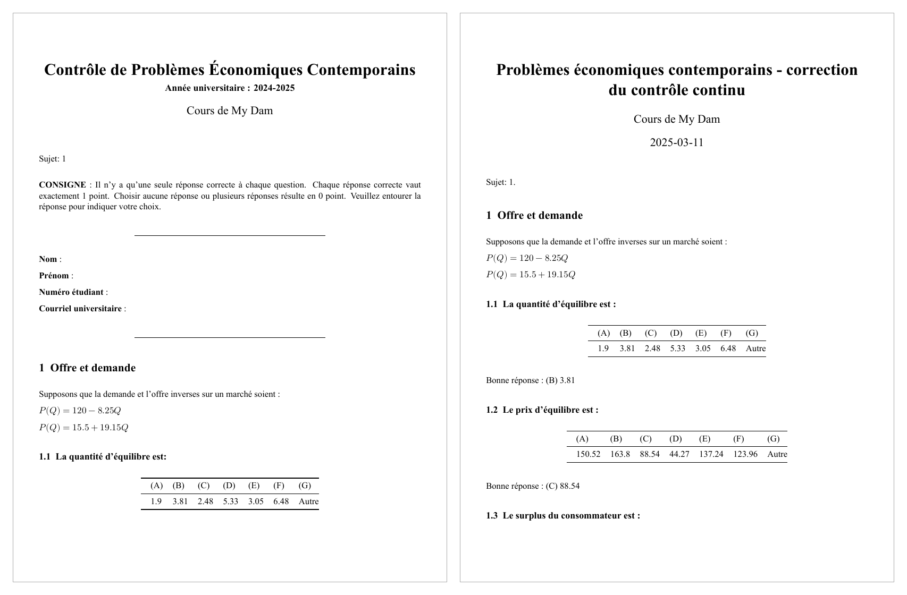

# MCQ exam generator

A randomized multiple-choice exam generator for undergraduate economics: every version has its own numbers, and each comes with a matching answer key, rendered to PDF with Quarto.



## Why

Each student receives a distinct version of the exam, which deters copying. All versions test the same skills with different parameters. For every version the tool also produces an answer key that lists the same options in the same order and gives the correct letter and value, so grading is mechanical. The tool was used to produce real exams for a large undergraduate course, *Problèmes Économiques Contemporains*.

## Question types

| Topic | What students compute |
|---|---|
| Supply and demand | Equilibrium quantity and price |
| Surplus | Consumer and producer surplus at equilibrium |
| Taxation | New price and quantity after a per-unit tax, deadweight loss, price elasticity of supply (midpoint formula). Tax-incidence questions are included but commented out by default; `TaxModel` also computes tax revenue. |
| Price controls | Price ceiling and price floor that shrink the market by 30%, with consumer and producer surplus under each |
| Monopoly | Monopoly quantity, price, profit (with a fixed cost), efficient quantity, deadweight loss |
| Cournot duopoly | Output per firm and market price with two identical firms |

**Distractors.** Each question has six options, (A) to (F), plus (G) "Autre" (other). The five wrong answers are distinct multiples of the correct answer, drawn from 0.5× to 1.85× in steps of 0.15 (1× excluded) and rounded to two decimals. They are then shuffled together with the correct answer. If rounding makes two options coincide (for very small or zero answers), the duplicates are replaced by offsets from the correct answer, so the six options are always distinct.

## How it works

```
config.py → main.py → renderingCodes.py → quarto render <template> -P sujet:N   (for each version N)
                                            ├─ pec-cc.qmd          → student copy PDF
                                            └─ pec-cc-answers.qmd  → answer key PDF

Both templates call exam.build_exam(N), which uses the models in pecModules.py.
```

- **`pecModules.py`**: the economic models (`LinearDSModel`, `TaxModel`, `PriceFloor`, `PriceCeiling`, `Monopole`) and helpers (`shuffleAnswer`, `computeElasticity`, `computeCS`, `computePS`).
- **`exam.py`**: `build_exam(N)` creates one random generator, `np.random.default_rng(N)`, draws the parameters, computes every correct answer and builds every option set. Because all randomness comes from this one seeded call, the same version number always gives the same exam.
- **`pec-cc.qmd` / `pec-cc-answers.qmd`**: Quarto templates holding the question text (in French). They receive the version number as a Quarto parameter (`sujet`), call `build_exam`, and only *display* the result. The answer key adds a line such as `Bonne réponse : (B) 3.81` under each question. Since both templates display the same precomputed questions, the key always matches the student copy.
- **`renderingCodes.py`**: loops over the version numbers and renders both templates to PDF. It uses a fresh kernel for each render and fixed PDF timestamps, so re-rendering a version gives byte-identical PDFs.

## Quick start

**Requirements**

- Python 3.10+ (tested with 3.11) with the packages in `requirements.txt`. Install them into the Python environment Quarto uses (check with `quarto check jupyter`).
- [Quarto](https://quarto.org/docs/get-started/) 1.4 or later.
- A LaTeX distribution with XeLaTeX. The simplest option is `quarto install tinytex`.
- The Times New Roman font, used by both templates. Elsewhere, change `mainfont` in the template headers.

**Install and run**

```bash
pip install -r requirements.txt
quarto install tinytex        # if you do not already have a LaTeX distribution
python main.py
```

Set the number of versions, the first version number and the output file names in `config.py`:

```python
number_of_copies = 2      # how many versions to render
premier_sujet = 1         # first version number
output_dir = 'generated_files'
sujet_output_name = 'pec-cc-sujet-{n}.pdf'
corrige_output_name = 'pec-cc-corr-{n}.pdf'
```

The PDFs are written to `generated_files/`. To render a single version by hand:

```bash
quarto render pec-cc.qmd -P sujet:7
quarto render pec-cc-answers.qmd -P sujet:7
```

**Tests**

```bash
pytest
```

The tests check the model formulas against hand-computed values (equilibrium, surplus, tax incidence, deadweight loss, price controls, monopoly and Cournot outcomes) and check that every version has distinct options and a valid answer letter.

## Example output

Sample PDFs for versions 1 and 2 are in [`examples/`](examples/):

| Version | Student copy | Answer key |
|---|---|---|
| 1 | [pec-cc-sujet-1.pdf](examples/pec-cc-sujet-1.pdf) | [pec-cc-corr-1.pdf](examples/pec-cc-corr-1.pdf) |
| 2 | [pec-cc-sujet-2.pdf](examples/pec-cc-sujet-2.pdf) | [pec-cc-corr-2.pdf](examples/pec-cc-corr-2.pdf) |

## Notes

- The exams are in French, because they are real course materials. The code, comments and documentation are in English.
- To add a question type, add a model or formula to `pecModules.py`, compute its answer with `ask(...)` in `exam.build_exam`, and add one display cell to each template.
